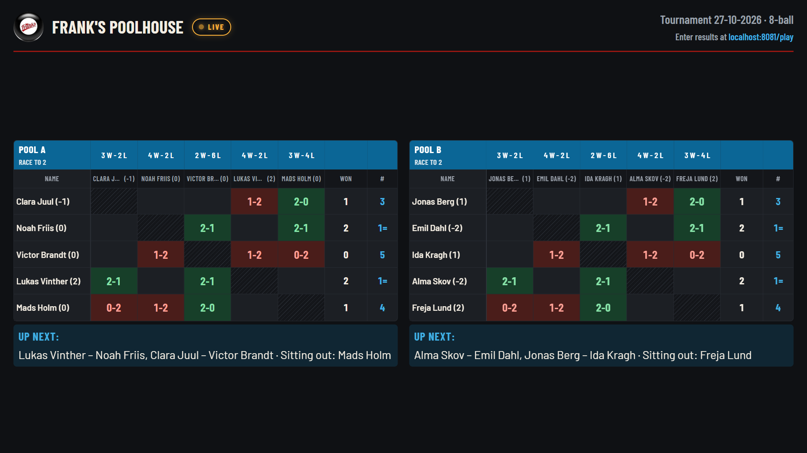
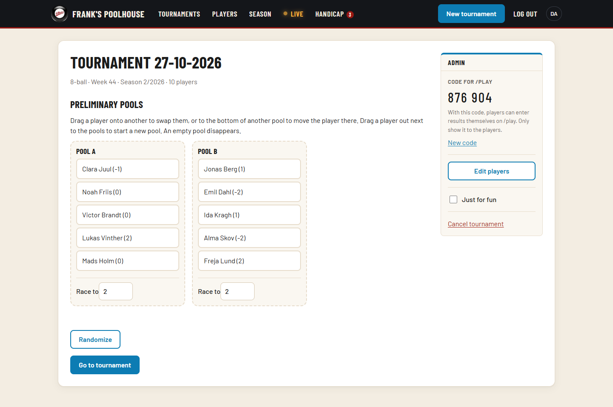
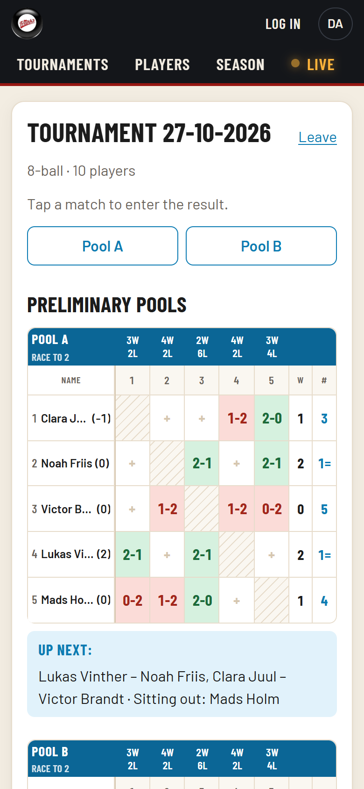
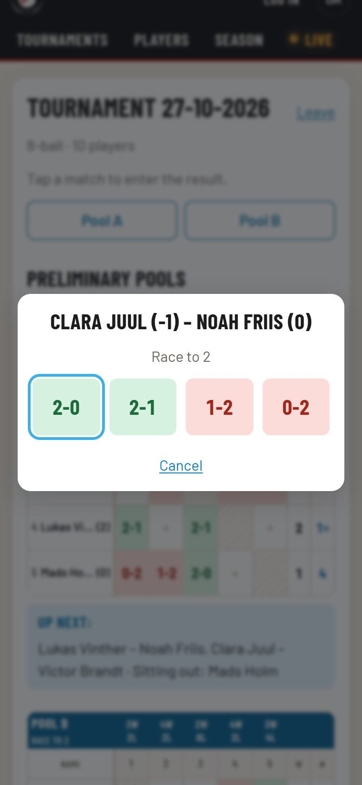
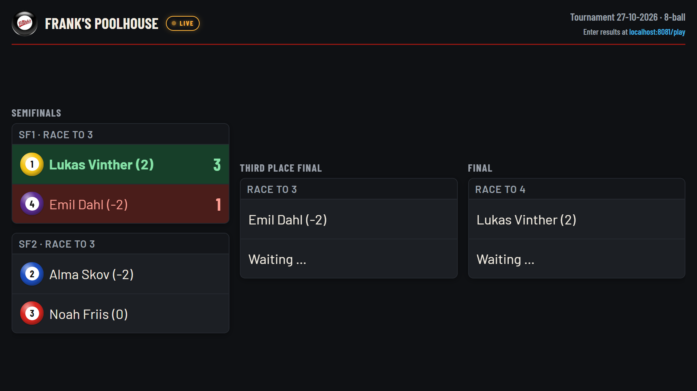
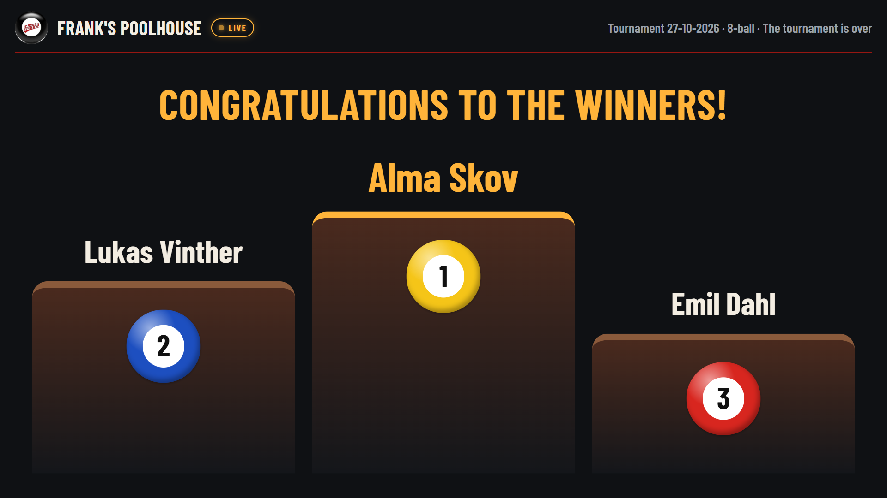
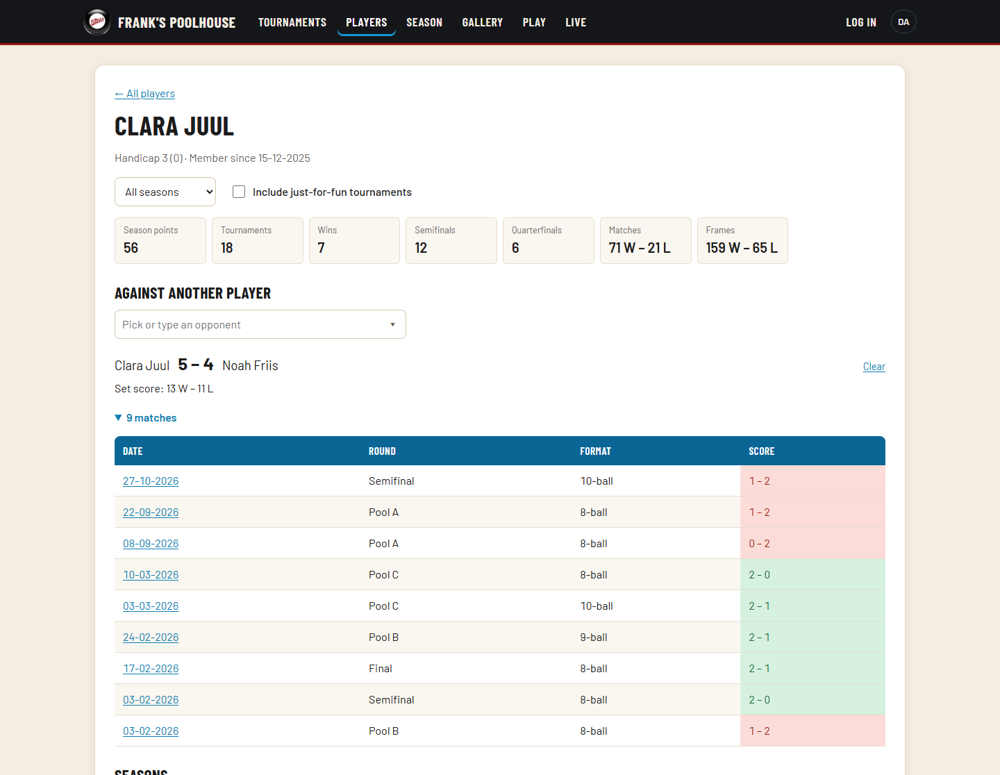
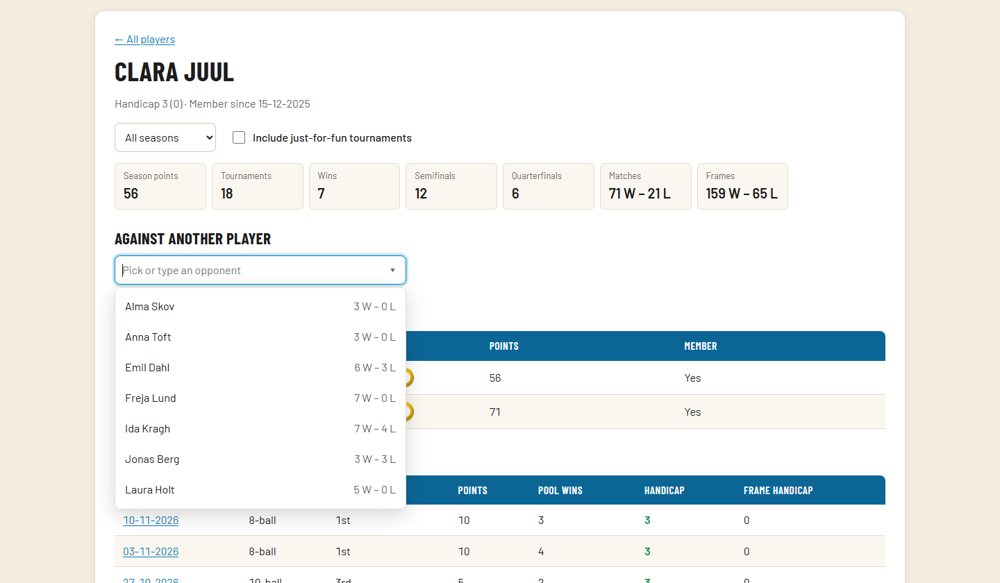
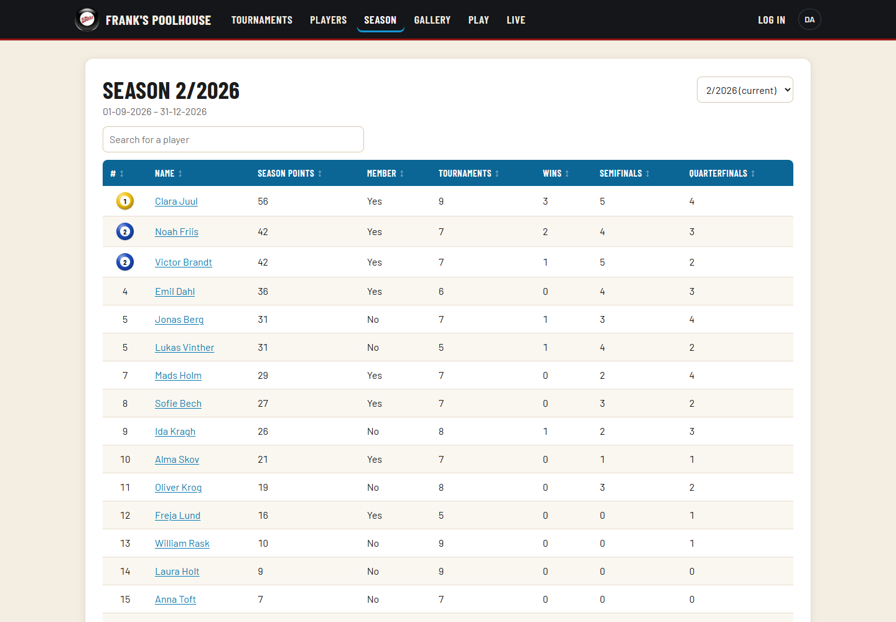
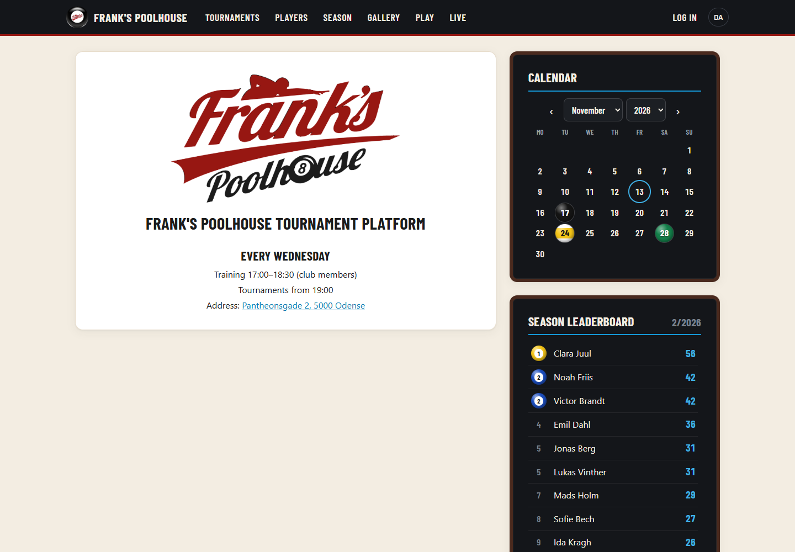

# Frank's Poolhouse — Tournament Platform

A web app that runs the weekly pool tournaments at Frank's Poolhouse in Odense, from the
pool draw to the season leaderboard. It replaced the club's Excel workbook and runs in
production at **[turneringsportal.kjaer-thomsen.dk](https://turneringsportal.kjaer-thomsen.dk)**.

The source code isn't public: this is a live service, developed together with Frank's Poolhouse,
that runs the club's real tournaments. This repository holds the write-up and screenshots.

Write-up: **[Building a Tournament Platform for My Local Pool Club](https://oskar.kjaer-thomsen.dk/blog/building-a-pool-tournament-platform)**

*The screenshots use made-up players, not the club's real data.*

## What it does

- **Setting up:** the tournament director adds tonight's players, the app draws them into
  pools, and the director can rearrange the pools by drag and drop before play starts.
- **Playing:** players enter their own results on their phones at `/play`, with a six-digit
  code from the director. Pool tables, standings and "Up next" update for everyone at once.
- **On the TV:** a flatscreen in the club shows `/live`: the pools during pool play, the bracket
  during the knockout, a podium at the end, and the season leaderboard between tournaments.
- **Afterwards:** the knockout is seeded from the pools, and concluding a tournament gives
  every player a placement, season points (with a member bonus) and a handicap review.

| Setting up | Playing on a phone |
|---|---|
|  |   |

| Knockout on the TV | When the tournament is concluded |
|---|---|
|  |  |

Tournaments come in a few kinds: 8-, 9- or 10-ball, a "just for fun" night that gives no points,
and doubles, where teams of two play as one entrant. When the pool matches still to be played
can't change who goes through, the knockout can start early, alongside them.

### Between tournaments

- **Player pages:** every player has a page with their statistics, match and frame record, their
  place in each season, and every tournament they played, filterable by season. A head-to-head
  picks from a dropdown of everyone they've played (or a typed name) and shows the record
  between them, with the matches behind it.
- **Seasons:** two a year, with a leaderboard for the current season and every earlier one.
  Older tournaments can be entered by hand from just their placings.
- **Handicaps:** the app keeps a hidden regulation score per player from their results and
  recommends a handicap change when it's due; an admin applies or dismisses it.
- **The club's frontpage:** a monthly calendar of coming events, the club's info as a text the
  admins edit (in both languages), and the season leaderboard.
- **Gallery:** photos from tournament nights, searchable by player, date, format and season;
  a tournament's winner photo is shown on its page.

| A player's page, with a head-to-head | Picking an opponent |
|---|---|
|  |  |

| The season leaderboard | The frontpage |
|---|---|
|  |  |

The interface is in Danish and English.

## Architecture

A TypeScript monorepo (npm workspaces) with three packages:

| Package | What it is |
|---|---|
| `packages/core` | The tournament rules as pure functions with no I/O: pool splits and draws, round-robin schedules, standings, qualification, seeding, the bracket, placements, points, seasons and handicaps |
| `apps/server` | A Fastify REST API on PostgreSQL (Drizzle ORM), with Server-Sent Events for live updates. It also serves the built frontend, so the app is one container |
| `apps/web` | A React app built with Vite, using TanStack Query and dnd-kit |

Both the server and the frontend use `core`, so each rule lives in one place. Randomness, such as
the pool draw, is passed into the functions, so tests use a seeded generator.

## Design decisions

- **Ties are flagged, not guessed.** Players are ranked by matches won, frame difference and
  head-to-head (a mini-league for three or more). Ties that can't be broken, like A > B > C > A,
  are flagged and the director orders them.
- **Live updates carry no state.** A Server-Sent Event only says which tournament changed, and
  every open page refetches. The first event also carries a version hash, so the TV reloads
  itself after a deploy.
- **A screen nobody can scroll.** `/live` is exactly one screen high and scales its content to
  fit, in a dark theme for a dim bar.
- **A code instead of player accounts.** Each tournament gets a six-digit code, shown on the TV
  in the club (only the players know the site's address), which admins can replace. Players can only fill in matches without a result, the first
  result counts, and join attempts are rate limited.
- **Rules enforced by the database too.** A partial unique index allows only one tournament in
  progress. Admin accounts can only be created with a CLI on the server; there is no sign-up
  route.

## Tests

The rules in `core` are unit tested with the club's own workbook results as fixtures, and the
API is covered by integration tests against a real PostgreSQL database: more than 260 test cases,
run with Vitest. Linting and type checks run across every workspace.

## Deployment

The app is built into one Docker image (multi-stage build). In production it runs on a Linux
server with Docker Compose, next to PostgreSQL and a container that takes nightly database
dumps. HTTPS comes from a Caddy reverse proxy. An update is a
`git pull` and a rebuild.
